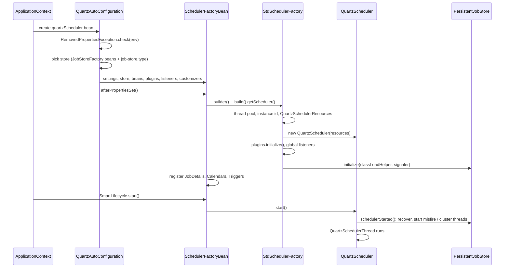
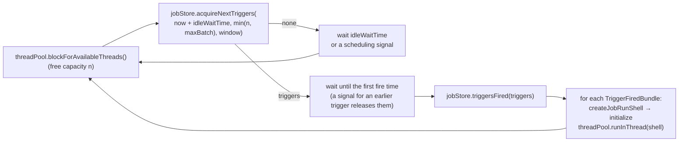
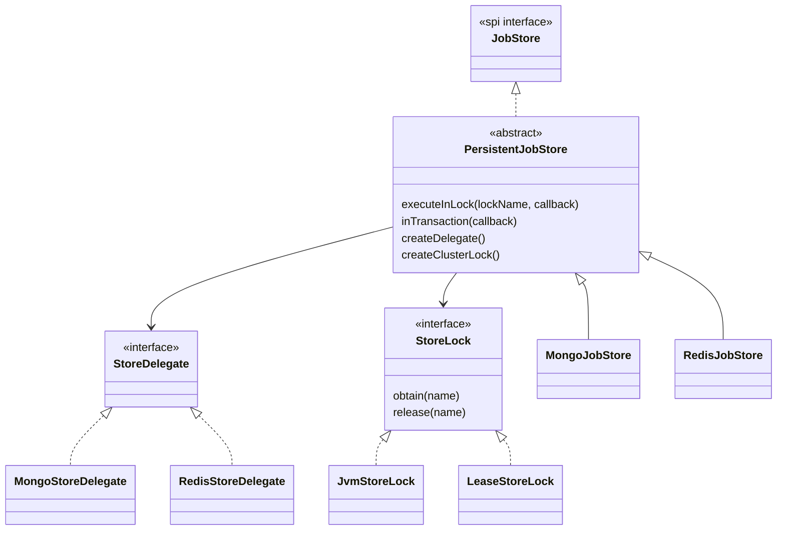
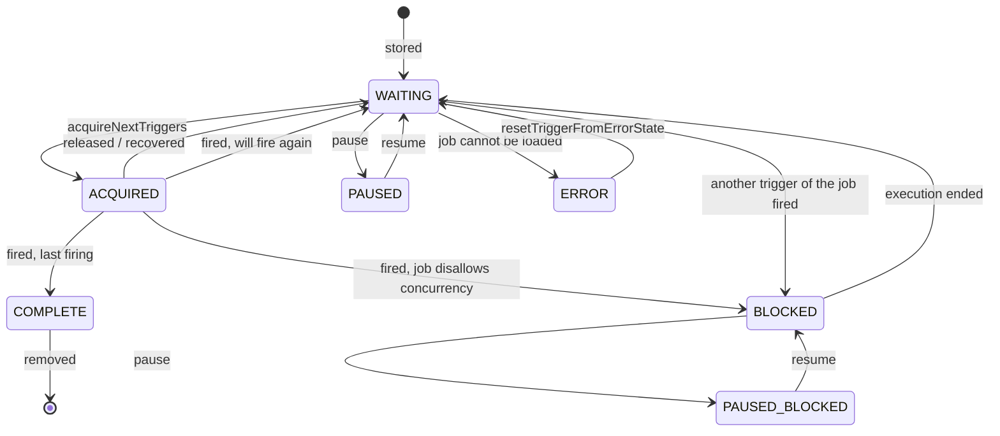

# Developer guide

`spring-boot-quartz-scheduler` is a job scheduling library for **Spring Boot 4** on **Java 25**. Applications
describe jobs and triggers with a builder API, the scheduler fires them on a pool of platform or virtual threads,
and all scheduling data is kept in **MongoDB** or **Redis**, so several application instances can share one
schedule as a cluster with fail-over. Everything is configured through `application.yml` and Spring beans.

This guide is for people working **on** the library: how it is built, how its parts fit together, and where to
make a change. For **using** it, read the [README](README.md). Design decisions are recorded in
[DECISIONS.md](DECISIONS.md) and cited here as `D-0xx` where the reason matters.

- [1. Design goals](#1-design-goals)
- [2. Architecture](#2-architecture)
- [3. Package map](#3-package-map)
- [4. Runtime: from startup to a job execution](#4-runtime-from-startup-to-a-job-execution)
- [5. Job stores](#5-job-stores)
- [6. Thread pools](#6-thread-pools)
- [7. Spring and Spring Boot integration](#7-spring-and-spring-boot-integration)
- [8. Configuration model](#8-configuration-model)
- [9. Conventions](#9-conventions)
- [10. Build and tooling](#10-build-and-tooling)
- [11. Testing](#11-testing)
- [12. How to …](#12-how-to-)
- [13. Invariants and pitfalls](#13-invariants-and-pitfalls)
- [14. Origins and licence](#14-origins-and-licence)

---

## 1. Design goals

- **Persistent and clusterable by default.** There is no in-memory store: jobs survive restarts, and any number
  of instances can share a store. A failed instance's work is recovered by the others.
- **Spring Boot native.** Typed `@ConfigurationProperties`, jobs/triggers/calendars/listeners/plugins as beans,
  connections taken from Spring Boot's own MongoDB and Redis configuration, actuator endpoint, health and
  metrics, failure analysis at startup.
- **Modern Java.** `java.time` throughout the API (`Instant`, `Duration`, `ZoneId`, `ZonedDateTime`),
  JSpecify nullness checked by the compiler, virtual threads as an option, `ScopedValue` for per-operation state.
- **Correct under failure.** Every store operation is atomic or recoverable when an instance is killed or
  interrupted mid-way (§13).
- **A small, explicit surface.** Few configuration keys with sensible defaults; options that have one right value
  in a Spring Boot application are fixed in code.

---

## 2. Architecture


Four layers, each building on the one before:

1. **Scheduler core** (`org.quartz`, `core`, `impl`, `simpl`, `spi`, triggers, calendars, matchers, listeners,
   plugins, `utils`): the scheduling engine and its public API. [`StdSchedulerFactory`](src/main/java/org/quartz/impl/StdSchedulerFactory.java) assembles a
   scheduler from typed settings and collaborators; [`SchedulerFactoryBean`](src/main/java/org/quartz/spring/SchedulerFactoryBean.java) drives it.
2. **Persistence** (`impl.store`, `impl.store.codec`, `impl.mongodb`, `impl.redis`): the [`JobStore`](src/main/java/org/quartz/spi/JobStore.java)
   implementations. [`PersistentJobStore`](src/main/java/org/quartz/impl/store/PersistentJobStore.java) holds every scheduling rule; each store only implements storage
   primitives ([`StoreDelegate`](src/main/java/org/quartz/impl/store/StoreDelegate.java)) and a cluster lock ([`StoreLock`](src/main/java/org/quartz/impl/store/StoreLock.java)).
3. **Spring integration** (`org.quartz.spring`): [`SchedulerFactoryBean`](src/main/java/org/quartz/spring/SchedulerFactoryBean.java) (lifecycle, beans → scheduler), the
   Spring-aware job factory, transactions around jobs, the executor-backed thread pool.
4. **Spring Boot** (`org.quartz.spring.boot`): auto-configuration from `application.yml` and beans, failure
   analysis, actuator endpoint, health indicator, Micrometer metrics.

---

## 3. Package map

| Package | Main types | Notes |
|---|---|---|
| `org.quartz` | [`Scheduler`](src/main/java/org/quartz/Scheduler.java), [`Job`](src/main/java/org/quartz/Job.java), [`JobDetail`](src/main/java/org/quartz/JobDetail.java), [`Trigger`](src/main/java/org/quartz/Trigger.java) and its sub-interfaces ([`SimpleTrigger`](src/main/java/org/quartz/SimpleTrigger.java), [`CronTrigger`](src/main/java/org/quartz/CronTrigger.java), [`CalendarIntervalTrigger`](src/main/java/org/quartz/CalendarIntervalTrigger.java), [`DailyTimeIntervalTrigger`](src/main/java/org/quartz/DailyTimeIntervalTrigger.java)), the builders ([`JobBuilder`](src/main/java/org/quartz/JobBuilder.java), [`TriggerBuilder`](src/main/java/org/quartz/TriggerBuilder.java), [`SimpleScheduleBuilder`](src/main/java/org/quartz/SimpleScheduleBuilder.java), [`CronScheduleBuilder`](src/main/java/org/quartz/CronScheduleBuilder.java), [`CalendarIntervalScheduleBuilder`](src/main/java/org/quartz/CalendarIntervalScheduleBuilder.java), [`DailyTimeIntervalScheduleBuilder`](src/main/java/org/quartz/DailyTimeIntervalScheduleBuilder.java), [`DateBuilder`](src/main/java/org/quartz/DateBuilder.java)), [`CronExpression`](src/main/java/org/quartz/CronExpression.java), [`TimeOfDay`](src/main/java/org/quartz/TimeOfDay.java), [`JobDataMap`](src/main/java/org/quartz/JobDataMap.java), [`JobListener`](src/main/java/org/quartz/JobListener.java), [`TriggerListener`](src/main/java/org/quartz/TriggerListener.java), [`SchedulerListener`](src/main/java/org/quartz/SchedulerListener.java), [`Calendar`](src/main/java/org/quartz/Calendar.java), annotations ([`DisallowConcurrentExecution`](src/main/java/org/quartz/DisallowConcurrentExecution.java), [`PersistJobDataAfterExecution`](src/main/java/org/quartz/PersistJobDataAfterExecution.java), [`ExecuteInTransaction`](src/main/java/org/quartz/ExecuteInTransaction.java)) | The public API: keep it stable |
| `org.quartz.core` | [`QuartzScheduler`](src/main/java/org/quartz/core/QuartzScheduler.java) (the engine), [`QuartzSchedulerThread`](src/main/java/org/quartz/core/QuartzSchedulerThread.java) (the scheduling loop), [`JobRunShell`](src/main/java/org/quartz/core/JobRunShell.java) (one execution), [`ListenerManagerImpl`](src/main/java/org/quartz/core/ListenerManagerImpl.java), [`QuartzSchedulerResources`](src/main/java/org/quartz/core/QuartzSchedulerResources.java), [`SchedulerSignalerImpl`](src/main/java/org/quartz/core/SchedulerSignalerImpl.java) | Internal; applications use [`StdScheduler`](src/main/java/org/quartz/impl/StdScheduler.java), which delegates here |
| `org.quartz.impl` | [`StdSchedulerFactory`](src/main/java/org/quartz/impl/StdSchedulerFactory.java), [`StdScheduler`](src/main/java/org/quartz/impl/StdScheduler.java), [`JobDetailImpl`](src/main/java/org/quartz/impl/JobDetailImpl.java), [`JobExecutionContextImpl`](src/main/java/org/quartz/impl/JobExecutionContextImpl.java) | |
| `org.quartz.impl.config` | [`SchedulerSettings`](src/main/java/org/quartz/impl/config/SchedulerSettings.java), [`ThreadPoolSettings`](src/main/java/org/quartz/impl/config/ThreadPoolSettings.java), [`JobStoreSettings`](src/main/java/org/quartz/impl/config/JobStoreSettings.java), [`QuartzSettings`](src/main/java/org/quartz/impl/config/QuartzSettings.java) | Immutable, validated records with builders and `defaults()`; every duration is a `Duration` |
| `org.quartz.impl.triggers` | [`AbstractTrigger`](src/main/java/org/quartz/impl/triggers/AbstractTrigger.java), [`SimpleTriggerImpl`](src/main/java/org/quartz/impl/triggers/SimpleTriggerImpl.java), [`CronTriggerImpl`](src/main/java/org/quartz/impl/triggers/CronTriggerImpl.java), [`CalendarIntervalTriggerImpl`](src/main/java/org/quartz/impl/triggers/CalendarIntervalTriggerImpl.java), [`DailyTimeIntervalTriggerImpl`](src/main/java/org/quartz/impl/triggers/DailyTimeIntervalTriggerImpl.java) | The fire-time algorithms, pinned by the golden tests (§11) |
| `org.quartz.impl.calendar` | [`BaseCalendar`](src/main/java/org/quartz/impl/calendar/BaseCalendar.java), [`AnnualCalendar`](src/main/java/org/quartz/impl/calendar/AnnualCalendar.java), [`CronCalendar`](src/main/java/org/quartz/impl/calendar/CronCalendar.java), [`DailyCalendar`](src/main/java/org/quartz/impl/calendar/DailyCalendar.java), [`HolidayCalendar`](src/main/java/org/quartz/impl/calendar/HolidayCalendar.java), [`MonthlyCalendar`](src/main/java/org/quartz/impl/calendar/MonthlyCalendar.java), [`WeeklyCalendar`](src/main/java/org/quartz/impl/calendar/WeeklyCalendar.java) | Exclusion calendars |
| `org.quartz.impl.matchers` | [`KeyMatcher`](src/main/java/org/quartz/impl/matchers/KeyMatcher.java), [`NameMatcher`](src/main/java/org/quartz/impl/matchers/NameMatcher.java), [`GroupMatcher`](src/main/java/org/quartz/impl/matchers/GroupMatcher.java), [`AndMatcher`](src/main/java/org/quartz/impl/matchers/AndMatcher.java), [`OrMatcher`](src/main/java/org/quartz/impl/matchers/OrMatcher.java), [`NotMatcher`](src/main/java/org/quartz/impl/matchers/NotMatcher.java), [`EverythingMatcher`](src/main/java/org/quartz/impl/matchers/EverythingMatcher.java) | Which jobs/triggers a listener sees |
| `org.quartz.impl.store` | [`PersistentJobStore`](src/main/java/org/quartz/impl/store/PersistentJobStore.java), [`StoreDelegate`](src/main/java/org/quartz/impl/store/StoreDelegate.java), [`StoreLock`](src/main/java/org/quartz/impl/store/StoreLock.java), [`JvmStoreLock`](src/main/java/org/quartz/impl/store/JvmStoreLock.java), [`LeaseStoreLock`](src/main/java/org/quartz/impl/store/LeaseStoreLock.java), [`FiredTriggerRecord`](src/main/java/org/quartz/impl/store/FiredTriggerRecord.java), [`SchedulerStateRecord`](src/main/java/org/quartz/impl/store/SchedulerStateRecord.java) | The store semantics (§5) |
| `org.quartz.impl.store.codec` | [`JobDetailCodec`](src/main/java/org/quartz/impl/store/codec/JobDetailCodec.java), [`TriggerCodec`](src/main/java/org/quartz/impl/store/codec/TriggerCodec.java), [`JobDataCodec`](src/main/java/org/quartz/impl/store/codec/JobDataCodec.java), [`SerializationCodec`](src/main/java/org/quartz/impl/store/codec/SerializationCodec.java), [`Fields`](src/main/java/org/quartz/impl/store/codec/Fields.java) | Store-neutral field maps; field names are the stored format |
| `org.quartz.impl.mongodb` | [`MongoJobStore`](src/main/java/org/quartz/impl/mongodb/MongoJobStore.java), [`MongoStoreDelegate`](src/main/java/org/quartz/impl/mongodb/MongoStoreDelegate.java), [`MongoJobStoreSettings`](src/main/java/org/quartz/impl/mongodb/MongoJobStoreSettings.java) | |
| `org.quartz.impl.redis` | [`RedisJobStore`](src/main/java/org/quartz/impl/redis/RedisJobStore.java), [`RedisStoreDelegate`](src/main/java/org/quartz/impl/redis/RedisStoreDelegate.java), [`RedisKeys`](src/main/java/org/quartz/impl/redis/RedisKeys.java), [`RedisScripts`](src/main/java/org/quartz/impl/redis/RedisScripts.java), [`RedisJobStoreSettings`](src/main/java/org/quartz/impl/redis/RedisJobStoreSettings.java) | |
| `org.quartz.simpl` | [`SimpleThreadPool`](src/main/java/org/quartz/simpl/SimpleThreadPool.java), [`VirtualThreadPool`](src/main/java/org/quartz/simpl/VirtualThreadPool.java), [`SimpleInstanceIdGenerator`](src/main/java/org/quartz/simpl/SimpleInstanceIdGenerator.java), [`SystemPropertyInstanceIdGenerator`](src/main/java/org/quartz/simpl/SystemPropertyInstanceIdGenerator.java) | |
| `org.quartz.spi` | [`JobStore`](src/main/java/org/quartz/spi/JobStore.java), [`ThreadPool`](src/main/java/org/quartz/spi/ThreadPool.java), [`JobFactory`](src/main/java/org/quartz/spi/JobFactory.java), [`SchedulerPlugin`](src/main/java/org/quartz/spi/SchedulerPlugin.java), [`InstanceIdGenerator`](src/main/java/org/quartz/spi/InstanceIdGenerator.java), [`OperableTrigger`](src/main/java/org/quartz/spi/OperableTrigger.java), [`TriggerFiredBundle`](src/main/java/org/quartz/spi/TriggerFiredBundle.java) | Extension interfaces |
| `org.quartz.listeners`, `org.quartz.plugins.*` | [`JobListenerSupport`](src/main/java/org/quartz/listeners/JobListenerSupport.java), [`TriggerListenerSupport`](src/main/java/org/quartz/listeners/TriggerListenerSupport.java), [`SchedulerListenerSupport`](src/main/java/org/quartz/listeners/SchedulerListenerSupport.java), the broadcasters; [`LoggingJobHistoryPlugin`](src/main/java/org/quartz/plugins/history/LoggingJobHistoryPlugin.java), [`LoggingTriggerHistoryPlugin`](src/main/java/org/quartz/plugins/history/LoggingTriggerHistoryPlugin.java), [`JobInterruptMonitorPlugin`](src/main/java/org/quartz/plugins/interrupt/JobInterruptMonitorPlugin.java) | Plugins are beans (D-030) |
| `org.quartz.utils` | [`Key`](src/main/java/org/quartz/utils/Key.java), [`DirtyFlagMap`](src/main/java/org/quartz/utils/DirtyFlagMap.java), [`StringKeyDirtyFlagMap`](src/main/java/org/quartz/utils/StringKeyDirtyFlagMap.java), [`LenientDateTime`](src/main/java/org/quartz/utils/LenientDateTime.java), [`Instants`](src/main/java/org/quartz/utils/Instants.java), [`InstantMessageFormat`](src/main/java/org/quartz/utils/InstantMessageFormat.java), [`ClassUtils`](src/main/java/org/quartz/utils/ClassUtils.java) | |
| `org.quartz.spring` | [`SchedulerFactoryBean`](src/main/java/org/quartz/spring/SchedulerFactoryBean.java), [`SchedulerAccessor`](src/main/java/org/quartz/spring/SchedulerAccessor.java), [`SpringBeanJobFactory`](src/main/java/org/quartz/spring/SpringBeanJobFactory.java), [`QuartzJobBean`](src/main/java/org/quartz/spring/QuartzJobBean.java), [`LocalTaskExecutorThreadPool`](src/main/java/org/quartz/spring/LocalTaskExecutorThreadPool.java), [`SpringTransactionJobRunShell`](src/main/java/org/quartz/spring/SpringTransactionJobRunShell.java), [`SpringTransactionJobRunShellFactory`](src/main/java/org/quartz/spring/SpringTransactionJobRunShellFactory.java), [`MongoJobDataTransactions`](src/main/java/org/quartz/spring/MongoJobDataTransactions.java) | Spring integration |
| `org.quartz.spring.boot.autoconfigure` | [`QuartzAutoConfiguration`](src/main/java/org/quartz/spring/boot/autoconfigure/QuartzAutoConfiguration.java), [`JobStoreConfigurations`](src/main/java/org/quartz/spring/boot/autoconfigure/JobStoreConfigurations.java), [`QuartzProperties`](src/main/java/org/quartz/spring/boot/autoconfigure/QuartzProperties.java), [`JobStoreUnavailableException`](src/main/java/org/quartz/spring/boot/autoconfigure/JobStoreUnavailableException.java), [`RemovedPropertiesException`](src/main/java/org/quartz/spring/boot/autoconfigure/RemovedPropertiesException.java) and their failure analyzers, [`QuartzEndpointAutoConfiguration`](src/main/java/org/quartz/spring/boot/autoconfigure/QuartzEndpointAutoConfiguration.java), [`QuartzHealthContributorAutoConfiguration`](src/main/java/org/quartz/spring/boot/autoconfigure/QuartzHealthContributorAutoConfiguration.java), [`QuartzMetricsAutoConfiguration`](src/main/java/org/quartz/spring/boot/autoconfigure/QuartzMetricsAutoConfiguration.java) | |
| `org.quartz.spring.boot.actuate.*` | [`QuartzEndpoint`](src/main/java/org/quartz/spring/boot/actuate/endpoint/QuartzEndpoint.java), [`QuartzEndpointWebExtension`](src/main/java/org/quartz/spring/boot/actuate/endpoint/QuartzEndpointWebExtension.java), [`QuartzHealthIndicator`](src/main/java/org/quartz/spring/boot/actuate/health/QuartzHealthIndicator.java), [`QuartzMetrics`](src/main/java/org/quartz/spring/boot/actuate/metrics/QuartzMetrics.java) | [`QuartzMetrics`](src/main/java/org/quartz/spring/boot/actuate/metrics/QuartzMetrics.java) is a scheduler plugin |

Every package is `@NullMarked` (§9).

---

## 4. Runtime: from startup to a job execution

### 4.1 Startup



The exact order is in [`StdSchedulerFactory.instantiate()`](src/main/java/org/quartz/impl/StdSchedulerFactory.java#L150).

### 4.2 The scheduling loop

[`QuartzSchedulerThread.run()`](src/main/java/org/quartz/core/QuartzSchedulerThread.java#L232):



Points that matter when changing it:

- The capacity reported by [`ThreadPool.blockForAvailableThreads()`](src/main/java/org/quartz/spi/ThreadPool.java#L68) bounds how many triggers are acquired: the
  smaller of the free capacity and `batch-trigger-acquisition-max-count`. Pools must report real capacity
  (D-023, D-027, D-031): an "unknown" answer serializes acquisition, an inflated one queues fired jobs where no
  other node can run them.
- [`ThreadPool.runInThread()`](src/main/java/org/quartz/spi/ThreadPool.java#L57) returning `false` puts the fired triggers into `ERROR`, so pools only refuse in
  exceptional cases.
- The scheduler thread is a platform thread even with virtual worker threads; it is interrupted when the
  scheduler halts.
- Scheduling time comes from [`SchedulerSignaler.getCurrentTime()`](src/main/java/org/quartz/spi/SchedulerSignaler.java#L79), i.e. the configured `java.time.Clock` (a
  `Clock` bean, or [`StdSchedulerFactory.Builder.clock()`](src/main/java/org/quartz/impl/StdSchedulerFactory.java#L456)), so tests can move time ([`MutableClock`](src/test/java/org/quartz/support/MutableClock.java)).

### 4.3 One job execution

[`JobRunShell.run()`](src/main/java/org/quartz/core/JobRunShell.java#L173):

1. The MDC gets [`JobRunShell.MDC_JOB_KEY`](src/main/java/org/quartz/core/JobRunShell.java#L63), [`JobRunShell.MDC_TRIGGER_KEY`](src/main/java/org/quartz/core/JobRunShell.java#L66), [`JobRunShell.MDC_FIRE_INSTANCE_ID`](src/main/java/org/quartz/core/JobRunShell.java#L69)
   (D-028).
2. [`JobRunShell.begin()`](src/main/java/org/quartz/core/JobRunShell.java#L330) is called.
3. Trigger and job listeners are told ([`TriggerListener.triggerFired()`](src/main/java/org/quartz/TriggerListener.java#L58), [`TriggerListener.vetoJobExecution()`](src/main/java/org/quartz/TriggerListener.java#L72),
   [`JobListener.jobToBeExecuted()`](src/main/java/org/quartz/JobListener.java#L58)); a veto skips the job.
4. [`JobRunShell.executeJob()`](src/main/java/org/quartz/core/JobRunShell.java#L320) runs the job. [`SpringTransactionJobRunShell`](src/main/java/org/quartz/spring/SpringTransactionJobRunShell.java) overrides it to run the job in a Spring
   transaction when the job class has [`ExecuteInTransaction`](src/main/java/org/quartz/ExecuteInTransaction.java) or `spring.quartz.transaction.enabled` is set.
5. [`JobListener.jobWasExecuted()`](src/main/java/org/quartz/JobListener.java#L74), then [`OperableTrigger.executionComplete()`](src/main/java/org/quartz/spi/OperableTrigger.java#L60) returns a
   [`Trigger.CompletedExecutionInstruction`](src/main/java/org/quartz/Trigger.java#L79), then [`TriggerListener.triggerComplete()`](src/main/java/org/quartz/TriggerListener.java#L96).
6. `RE_EXECUTE_JOB` runs the job again; otherwise [`JobStore.triggeredJobComplete()`](src/main/java/org/quartz/spi/JobStore.java#L616) stores the outcome.
7. The MDC keys are removed (pool threads are reused).

The job instance comes from the [`JobFactory`](src/main/java/org/quartz/spi/JobFactory.java): with Spring, [`SpringBeanJobFactory`](src/main/java/org/quartz/spring/SpringBeanJobFactory.java) autowires the job and applies
[`JobDataMap`](src/main/java/org/quartz/JobDataMap.java) values to its setters.

### 4.4 Shutdown

[`SchedulerFactoryBean.onApplicationEvent()`](src/main/java/org/quartz/spring/SchedulerFactoryBean.java#L660) shuts the scheduler down on its context's `ContextClosedEvent`,
**before** the context stops its lifecycle beans, so the store's connection (`LettuceConnectionFactory`, the
`MongoClient`) is still open while running jobs report completion (D-018). With
`spring.quartz.wait-for-jobs-to-complete-on-shutdown` the thread pool waits for running jobs. The scheduler
thread is interrupted, which is why every store call must survive an interrupt (§13).

---

## 5. Job stores

### 5.1 Structure



[`PersistentJobStore`](src/main/java/org/quartz/impl/store/PersistentJobStore.java) implements every scheduling rule: trigger states, paused groups, blocking of non-concurrent
jobs, misfires, recovery and clustering. A [`StoreDelegate`](src/main/java/org/quartz/impl/store/StoreDelegate.java) only reads and writes, and each of its methods must be
**atomic on its own** (one conditional update, one Lua script). Compound operations run in
[`PersistentJobStore.executeInLock()`](src/main/java/org/quartz/impl/store/PersistentJobStore.java#L464):

- The lock is a [`JvmStoreLock`](src/main/java/org/quartz/impl/store/JvmStoreLock.java) (in-process) for a non-clustered store, and a [`LeaseStoreLock`](src/main/java/org/quartz/impl/store/LeaseStoreLock.java) in the database
  for a clustered one ([`PersistentJobStore.createClusterLock()`](src/main/java/org/quartz/impl/store/PersistentJobStore.java#L186)).
- [`PersistentJobStore.inTransaction()`](src/main/java/org/quartz/impl/store/PersistentJobStore.java#L195) wraps the callback in a MongoDB transaction when the deployment supports
  them ([`MongoJobStore.inTransaction()`](src/main/java/org/quartz/impl/mongodb/MongoJobStore.java#L236)); Redis has none.
- The per-operation state (held locks, the pending scheduling signal, the MongoDB session) is a `ScopedValue`
  bound for the operation (D-022).

### 5.2 Trigger states



The stored values are the [`PersistentJobStore.STATE_WAITING`](src/main/java/org/quartz/impl/store/PersistentJobStore.java#L87) … [`PersistentJobStore.STATE_PAUSED_BLOCKED`](src/main/java/org/quartz/impl/store/PersistentJobStore.java#L108)
constants; [`Trigger.TriggerState`](src/main/java/org/quartz/Trigger.java#L54) is what the API reports.

Next to the trigger, a **fired-trigger record** ([`FiredTriggerRecord`](src/main/java/org/quartz/impl/store/FiredTriggerRecord.java)) exists for every trigger an instance has
acquired (`ACQUIRED`) or is executing (`EXECUTING`), naming the instance. Recovery works from these records:

- **Acquisition writes the record first** (D-034). In [`PersistentJobStore.acquireNextTriggers()`](src/main/java/org/quartz/impl/store/PersistentJobStore.java#L1225) the record is
  inserted **before** the `WAITING → ACQUIRED` change and deleted if another instance wins the trigger. A store
  without transactions performs the two writes separately; an instance that stops between them must leave a
  record, or recovery could not free the trigger. A record for a trigger that is still `WAITING` is harmless.
- **Recovery** of a failed instance frees its `ACQUIRED` triggers (unless another instance has a record for
  them), re-schedules jobs with [`JobDetail.requestsRecovery()`](src/main/java/org/quartz/JobDetail.java#L107) that were executing, unblocks non-concurrent jobs, and
  deletes its records.

### 5.3 Background threads

| Thread | When | What |
|---|---|---|
| misfire handler | always | Applies misfire instructions to triggers whose next fire time is older than `now − misfire-threshold` ([`PersistentJobStore.recoverMisfiredJobs()`](src/main/java/org/quartz/impl/store/PersistentJobStore.java#L1533)), at most `max-misfires-to-handle-at-a-time` per pass; a pass runs every `misfire-threshold`, sooner when the last one left triggers over |
| cluster manager | clustered | Checks in every `cluster-checkin-interval` ([`SchedulerStateRecord`](src/main/java/org/quartz/impl/store/SchedulerStateRecord.java)), detects instances whose check-in is older than interval + `cluster-checkin-misfire-threshold`, and recovers them under the [`PersistentJobStore.LOCK_STATE_ACCESS`](src/main/java/org/quartz/impl/store/PersistentJobStore.java#L114) and [`PersistentJobStore.LOCK_TRIGGER_ACCESS`](src/main/java/org/quartz/impl/store/PersistentJobStore.java#L111) locks |

When the scheduler starts ([`PersistentJobStore.schedulerStarted()`](src/main/java/org/quartz/impl/store/PersistentJobStore.java#L323)) a store frees its own `ACQUIRED` and `BLOCKED`
triggers, removes stale fired records and recovers the in-progress jobs of its previous run; a clustered store
does this through its first check-in.

### 5.4 Locks

[`LeaseStoreLock`](src/main/java/org/quartz/impl/store/LeaseStoreLock.java) (both stores): a lease is "owner id + expiry", written atomically; other instances poll every
50 ms ([`JobStoreSettings.acquireTriggersWithinLockRetry()`](src/main/java/org/quartz/impl/config/JobStoreSettings.java#L46)) until it is released or has expired. A dead instance
blocks the others for at most the lease time ([`MongoJobStoreSettings.lockTimeout()`](src/main/java/org/quartz/impl/mongodb/MongoJobStoreSettings.java#L25), 10 min by default;
[`RedisJobStoreSettings.lockTimeout()`](src/main/java/org/quartz/impl/redis/RedisJobStoreSettings.java#L25), 30 s). [`LeaseStoreLock.release()`](src/main/java/org/quartz/impl/store/LeaseStoreLock.java#L110) clears the thread's interrupt flag first: the
scheduler thread interrupted at shutdown must still give its lease back.

### 5.5 MongoDB store

- **Collections** (prefix `qrtz_`): `jobs`, `triggers`, `calendars`, `paused_groups`, `fired_triggers`,
  `schedulers`, `locks`. Every document carries the scheduler name, so several schedulers can share them; indexes
  are created at startup (tested by [`MongoIndexesIT`](src/test/java/org/quartz/impl/mongodb/MongoIndexesIT.java)).
- **Database:** the application's: the `MongoDatabaseFactory`'s, else `spring.mongodb.database`, else the
  connection string's ([`JobStoreConfigurations.MongoJobStoreConfiguration`](src/main/java/org/quartz/spring/boot/autoconfigure/JobStoreConfigurations.java#L61), D-030, D-032).
- **Transactions:** on a replica set or sharded cluster every store operation is a transaction, and trigger
  acquisition always takes the trigger lock ([`MongoJobStore.acquireTriggersWithinLock()`](src/main/java/org/quartz/impl/mongodb/MongoJobStore.java#L231)) to avoid write conflicts.
  On a standalone server the store still works: each primitive is one atomic operation.
- **Failure safety:** a failed transaction is aborted with the interrupt flag cleared, and its server session is
  killed and marked dirty ([`MongoJobStore.abort()`](src/main/java/org/quartz/impl/mongodb/MongoJobStore.java#L263)), because the driver ignores abort errors and an open
  transaction would hold its locks for 60 s (D-032).
- **Job transactions:** with a `MongoTransactionManager` on the same `MongoClient`, the job data of a
  [`PersistJobDataAfterExecution`](src/main/java/org/quartz/PersistJobDataAfterExecution.java) job is written in the job's own transaction ([`MongoJobDataTransactions`](src/main/java/org/quartz/spring/MongoJobDataTransactions.java),
  [`MongoJobStore.updateJobData()`](src/main/java/org/quartz/impl/mongodb/MongoJobStore.java#L130)).
- **Lease locks** are documents in `locks` with an `expiresAt` (also under a TTL index as a safety net).

### 5.6 Redis store

- **Keys** are `{keyPrefix}{schedName}:…` (prefix `quartz:`); the `{schedName}` hash tag keeps a scheduler in one
  slot, so Redis Cluster works. The layout is defined in [`RedisKeys`](src/main/java/org/quartz/impl/redis/RedisKeys.java): `job:<k>`, `jobs:<group>`, `job_groups`,
  `trigger:<k>`, `triggers:<group>`, `trigger_groups`, `job_triggers:<k>`, `calendar_triggers:<name>`,
  `state:<STATE>`, `waiting` and `waiting_ignore_misfire` (sorted by next fire time), `calendars`,
  `paused_trigger_groups`, `paused_job_groups`, `fired:<id>`, `fired_ids`, `fired_by_instance:<id>`,
  `fired_by_job:<k>`, `fired_by_trigger:<k>`, `fired_instances`, `schedulers`, `lock:<name>`. Names are escaped
  (`%`, `:`).
- **Atomicity:** every multi-key change is one Lua script in [`RedisScripts`](src/main/java/org/quartz/impl/redis/RedisScripts.java) ([`RedisScripts.STORE_JOB`](src/main/java/org/quartz/impl/redis/RedisScripts.java#L40),
  [`RedisScripts.STORE_TRIGGER`](src/main/java/org/quartz/impl/redis/RedisScripts.java#L118), the conditional [`RedisScripts.SET_STATE`](src/main/java/org/quartz/impl/redis/RedisScripts.java#L157), [`RedisScripts.INSERT_FIRED`](src/main/java/org/quartz/impl/redis/RedisScripts.java#L184),
  [`RedisScripts.DELETE_FIRED`](src/main/java/org/quartz/impl/redis/RedisScripts.java#L227), [`RedisScripts.ACQUIRE_LOCK`](src/main/java/org/quartz/impl/redis/RedisScripts.java#L266), [`RedisScripts.RELEASE_LOCK`](src/main/java/org/quartz/impl/redis/RedisScripts.java#L278), …), tested by
  [`RedisLuaScriptsIT`](src/test/java/org/quartz/impl/redis/RedisLuaScriptsIT.java). There are no transactions across scripts, hence the write-order rules of §5.2.
- **Leases:** `SET NX PX`, released by compare-and-delete.
- **Durability** is Redis's: use AOF persistence (`appendonly yes`).

### 5.7 Codecs

[`JobDetailCodec`](src/main/java/org/quartz/impl/store/codec/JobDetailCodec.java) and [`TriggerCodec`](src/main/java/org/quartz/impl/store/codec/TriggerCodec.java) turn jobs and triggers into store-neutral `Map<String, Object>`s: MongoDB
stores them as documents, Redis as hashes of strings. Instants are epoch milliseconds; the four built-in trigger
types have their own fields, other trigger types are Java-serialized ([`TriggerCodec.TYPE_BLOB`](src/main/java/org/quartz/impl/store/codec/TriggerCodec.java#L135)). [`JobDataCodec`](src/main/java/org/quartz/impl/store/codec/JobDataCodec.java)
keeps simple job data values typed (type-tagged strings in Redis) and Java-serializes the map when a value is not
simple. The constants (for example [`TriggerCodec.NEXT_FIRE_TIME`](src/main/java/org/quartz/impl/store/codec/TriggerCodec.java#L66), [`JobDetailCodec.JOB_CLASS`](src/main/java/org/quartz/impl/store/codec/JobDetailCodec.java#L40)) are the stored field
names: **renaming one is a data migration**.

---

## 6. Thread pools

| Pool | Selected by | Capacity reported | Notes |
|---|---|---|---|
| [`SimpleThreadPool`](src/main/java/org/quartz/simpl/SimpleThreadPool.java) | default | free worker threads | `thread-count` platform threads |
| [`VirtualThreadPool`](src/main/java/org/quartz/simpl/VirtualThreadPool.java) | `spring.quartz.thread-pool.virtual-threads: true`, or [`ThreadPoolSettings.virtualThreads()`](src/main/java/org/quartz/impl/config/ThreadPoolSettings.java#L43) | `thread-count` minus running jobs | A new virtual thread per job; independent of `spring.threads.virtual.enabled` (D-027) |
| [`LocalTaskExecutorThreadPool`](src/main/java/org/quartz/spring/LocalTaskExecutorThreadPool.java) | [`SchedulerFactoryBean.setTaskExecutor()`](src/main/java/org/quartz/spring/SchedulerFactoryBean.java#L175) (for example from a [`SchedulerFactoryBeanCustomizer`](src/main/java/org/quartz/spring/boot/autoconfigure/SchedulerFactoryBeanCustomizer.java)), or [`SchedulerFactoryBean.setThreadPool()`](src/main/java/org/quartz/spring/SchedulerFactoryBean.java#L183) with an explicit capacity | the executor's real limit; an executor without one is capped at `thread-count` (D-023, D-031) | Reads `ThreadPoolTaskExecutor`, `ThreadPoolExecutor`, `ThreadPoolTaskScheduler`, `ConcurrentTaskExecutor` and a limited `SimpleAsyncTaskExecutor`; warns when it cannot |

[`StdSchedulerFactory.createThreadPool()`](src/main/java/org/quartz/impl/StdSchedulerFactory.java#L269) picks between the first two. Each pool's [`ThreadPool.describe()`](src/main/java/org/quartz/spi/ThreadPool.java#L92) appears in
the startup summary. A new pool must implement [`ThreadPool.blockForAvailableThreads()`](src/main/java/org/quartz/spi/ThreadPool.java#L68) truthfully, free its slot on
every failure path, and wait in [`ThreadPool.shutdown()`](src/main/java/org/quartz/spi/ThreadPool.java#L82) when asked to.

---

## 7. Spring and Spring Boot integration

### 7.1 [`SchedulerFactoryBean`](src/main/java/org/quartz/spring/SchedulerFactoryBean.java)

[`SchedulerFactoryBean`](src/main/java/org/quartz/spring/SchedulerFactoryBean.java) builds the scheduler with [`StdSchedulerFactory.Builder`](src/main/java/org/quartz/impl/StdSchedulerFactory.java#L326). It is a `FactoryBean<Scheduler>`,
a `SmartLifecycle` (it starts once the context is refreshed, after an optional
[`SchedulerFactoryBean.setStartupDelay()`](src/main/java/org/quartz/spring/SchedulerFactoryBean.java#L352)) and an `ApplicationListener<ContextClosedEvent>` (§4.4). It registers jobs,
triggers and calendars once the scheduler exists ([`SchedulerAccessor.setOverwriteExistingJobs()`](src/main/java/org/quartz/spring/SchedulerAccessor.java#L77), inherited), installs
[`SpringBeanJobFactory`](src/main/java/org/quartz/spring/SpringBeanJobFactory.java) and, inside an application context, [`SpringTransactionJobRunShellFactory`](src/main/java/org/quartz/spring/SpringTransactionJobRunShellFactory.java), which runs
[`ExecuteInTransaction`](src/main/java/org/quartz/ExecuteInTransaction.java) jobs (or every job, with [`SchedulerFactoryBean.setTransactionalJobs()`](src/main/java/org/quartz/spring/SchedulerFactoryBean.java#L295)) in a Spring
transaction.

### 7.2 Auto-configuration

[`QuartzAutoConfiguration`](src/main/java/org/quartz/spring/boot/autoconfigure/QuartzAutoConfiguration.java) runs after Spring Boot's MongoDB, Spring Data MongoDB and Redis auto-configurations. Its
[`QuartzAutoConfiguration.quartzScheduler()`](src/main/java/org/quartz/spring/boot/autoconfigure/QuartzAutoConfiguration.java#L81) bean:

- is created unless the application defines a [`Scheduler`](src/main/java/org/quartz/Scheduler.java) or [`SchedulerFactoryBean`](src/main/java/org/quartz/spring/SchedulerFactoryBean.java);
- collects [`JobDetail`](src/main/java/org/quartz/JobDetail.java), [`Trigger`](src/main/java/org/quartz/Trigger.java), [`Calendar`](src/main/java/org/quartz/Calendar.java) (by bean name), [`JobListener`](src/main/java/org/quartz/JobListener.java), [`TriggerListener`](src/main/java/org/quartz/TriggerListener.java),
  [`SchedulerListener`](src/main/java/org/quartz/SchedulerListener.java) and [`SchedulerPlugin`](src/main/java/org/quartz/spi/SchedulerPlugin.java) (by bean name) beans, a unique `Clock` and [`InstanceIdGenerator`](src/main/java/org/quartz/spi/InstanceIdGenerator.java), and
  applies [`SchedulerFactoryBeanCustomizer`](src/main/java/org/quartz/spring/boot/autoconfigure/SchedulerFactoryBeanCustomizer.java) beans last; plugin beans that are also listeners register themselves,
  so they are not added again as global listeners (D-032);
- picks the store from the [`JobStoreFactory`](src/main/java/org/quartz/spring/boot/autoconfigure/JobStoreFactory.java) beans ([`JobStoreConfigurations`](src/main/java/org/quartz/spring/boot/autoconfigure/JobStoreConfigurations.java) registers one per store whose
  client and connection bean are present) and `spring.quartz.job-store.type`, failing with
  [`JobStoreUnavailableException`](src/main/java/org/quartz/spring/boot/autoconfigure/JobStoreUnavailableException.java);
- fails with [`RemovedPropertiesException`](src/main/java/org/quartz/spring/boot/autoconfigure/RemovedPropertiesException.java) when the environment sets a removed `spring.quartz.*` key (D-032).

Both exceptions have a failure analyzer ([`JobStoreUnavailableFailureAnalyzer`](src/main/java/org/quartz/spring/boot/autoconfigure/JobStoreUnavailableFailureAnalyzer.java), [`RemovedPropertiesFailureAnalyzer`](src/main/java/org/quartz/spring/boot/autoconfigure/RemovedPropertiesFailureAnalyzer.java))
registered in [`META-INF/spring.factories`](src/main/resources/META-INF/spring.factories). The
auto-configuration classes are listed in
[`AutoConfiguration.imports`](src/main/resources/META-INF/spring/org.springframework.boot.autoconfigure.AutoConfiguration.imports).

### 7.3 Actuator

[`QuartzEndpointAutoConfiguration`](src/main/java/org/quartz/spring/boot/autoconfigure/QuartzEndpointAutoConfiguration.java), [`QuartzHealthContributorAutoConfiguration`](src/main/java/org/quartz/spring/boot/autoconfigure/QuartzHealthContributorAutoConfiguration.java) and [`QuartzMetricsAutoConfiguration`](src/main/java/org/quartz/spring/boot/autoconfigure/QuartzMetricsAutoConfiguration.java)
add the `quartz` endpoint ([`QuartzEndpoint`](src/main/java/org/quartz/spring/boot/actuate/endpoint/QuartzEndpoint.java), [`QuartzEndpointWebExtension`](src/main/java/org/quartz/spring/boot/actuate/endpoint/QuartzEndpointWebExtension.java)), the `quartz` health indicator
([`QuartzHealthIndicator`](src/main/java/org/quartz/spring/boot/actuate/health/QuartzHealthIndicator.java): DOWN when the scheduler is shut down, its store cannot be read, or its cluster check-in
is overdue) and Micrometer meters ([`QuartzMetrics`](src/main/java/org/quartz/spring/boot/actuate/metrics/QuartzMetrics.java), a scheduler plugin listening to jobs and triggers). The
README's Actuator section has the user view.

---

## 8. Configuration model

```mermaid
flowchart LR
  yml["application.yml<br/>spring.quartz.*"] --> qp["QuartzProperties<br/>(records, @DefaultValue)"]
  qp -->|toSettings()| s["SchedulerSettings<br/>ThreadPoolSettings<br/>JobStoreSettings"]
  qp --> m["MongoJobStoreSettings<br/>RedisJobStoreSettings"]
  s --> sfb["SchedulerFactoryBean.setSettings"] --> f["StdSchedulerFactory.Builder"]
  m --> st["MongoJobStore / RedisJobStore constructors"]
```

- [`QuartzProperties`](src/main/java/org/quartz/spring/boot/autoconfigure/QuartzProperties.java) is the only binding target, and every duration is a `Duration`. It exposes a deliberate set
  of 29 keys; options with one sensible value in a Spring Boot application are not properties and keep the
  defaults of the settings records (D-030). Plain Java users can still set them on the builders, for example
  [`JobStoreSettings.Builder.useProperties()`](src/main/java/org/quartz/impl/config/JobStoreSettings.java#L233).
- The settings records validate in their compact constructors and have builders; their `defaults()` equal the
  property defaults apart from the scheduler name ([`QuartzPropertiesTest.defaultsMatchTheTypedSettingsDefaults()`](src/test/java/org/quartz/spring/boot/autoconfigure/QuartzPropertiesTest.java#L36)).
- **Metadata:** `spring-boot-configuration-processor` generates `META-INF/spring-configuration-metadata.json` from
  the records' Javadoc `@param`s (written as sentences). Hints and the removed keys (error-level deprecations) are
  added by
  [`additional-spring-configuration-metadata.json`](src/main/resources/META-INF/additional-spring-configuration-metadata.json).
  The README's property table is generated from the merged file, and [`ConfigurationMetadataTest`](src/test/java/org/quartz/spring/boot/autoconfigure/ConfigurationMetadataTest.java) checks it.

---

## 9. Conventions

- **Time:** the API uses `java.time` throughout. The fire-time algorithms do their calendar arithmetic with
  [`LenientDateTime`](src/main/java/org/quartz/utils/LenientDateTime.java) (lenient field arithmetic with well-defined daylight-saving behaviour), and instants are kept at
  millisecond precision ([`Instants.toMillis()`](src/main/java/org/quartz/utils/Instants.java#L36)). Message templates with `{n, date, …}` elements are formatted by
  [`InstantMessageFormat.format()`](src/main/java/org/quartz/utils/InstantMessageFormat.java#L46).
- **Nullness:** every package is `@NullMarked` (JSpecify) and **NullAway fails the build** (D-025, D-026). Mark
  `@Nullable` wherever null is possible; fields set after construction take `@SuppressWarnings("NullAway.Init")`;
  any `@SuppressWarnings("NullAway")` carries a comment saying why. Null-in/null-out helpers use Spring's
  `@Contract` (see [`Instants.toMillis()`](src/main/java/org/quartz/utils/Instants.java#L36)).
- **Package of Spring code:** `org.quartz.spring…`, never `org.springframework.…`, so the library cannot clash with
  Spring's own modules.
- **Licence headers:** Apache 2.0 on every file.
- **Logging:** SLF4J only.
- **Decisions:** anything ambiguous gets a `DECISIONS.md` entry, with the conservative choice taken.

---

## 10. Build and tooling

| Item | Detail |
|---|---|
| JDK | 25 ([`.sdkmanrc`](.sdkmanrc): Temurin 25.0.4); the enforcer requires 25 or newer |
| Build | The Maven wrapper: `./mvnw verify` runs unit and container tests, NullAway and the dependency analysis ([`pom.xml`](pom.xml)) |
| Formatting | `fmt-maven-plugin` (google-java-format) **rewrites the sources on every build**: commit what it produces; `-Dfmt.skip` skips it locally |
| Static checks | Error Prone with only NullAway enabled, on the main code (D-025); [`.mvn/jvm.config`](.mvn/jvm.config) opens the `jdk.compiler` internals it needs |
| Dependencies | `dependency:analyze-only` with `failOnWarning`: declare what you use, nothing more. Store and actuator dependencies are `optional` |
| Javadoc | `./mvnw javadoc:javadoc`. The sources and javadoc jars are built only by the `publish-artefacts` profile (D-029); check them before a release with `./mvnw -Ppublish-artefacts -Dgpg.skip -DskipTests package` |
| Release | The `publish-artefacts` profile: sources, javadoc, GPG signing, `central-publishing-maven-plugin` |
| Version | Set in `pom.xml`; the filtered [`quartz-build.properties`](src/main/resources/org/quartz/core/quartz-build.properties) carries it to [`QuartzScheduler.getVersion()`](src/main/java/org/quartz/core/QuartzScheduler.java#L246) |

After changing the Java release or the plugin set, run `clean verify`: incremental builds have kept stale classes.

---

## 11. Testing

| Kind | Where | What |
|---|---|---|
| Unit | `*Test`, Surefire, one JVM per class | API, triggers, calendars, codecs, settings, thread pools, Spring pieces without a store |
| Container | `*IT`, Failsafe | Anything touching MongoDB or Redis, with real containers |
| Store contract | [`AbstractJobStoreContractTest`](src/test/java/org/quartz/store/AbstractJobStoreContractTest.java), [`AbstractClusteredJobStoreContractTest`](src/test/java/org/quartz/store/AbstractClusteredJobStoreContractTest.java) | One suite run against both stores ([`MongoJobStoreIT`](src/test/java/org/quartz/impl/mongodb/MongoJobStoreIT.java), [`RedisJobStoreIT`](src/test/java/org/quartz/impl/redis/RedisJobStoreIT.java), [`MongoClusteredJobStoreIT`](src/test/java/org/quartz/impl/mongodb/MongoClusteredJobStoreIT.java), [`RedisClusteredJobStoreIT`](src/test/java/org/quartz/impl/redis/RedisClusteredJobStoreIT.java)): add store behaviour tests **here** |
| Golden | [`GoldenBehaviourTest`](src/test/java/org/quartz/GoldenBehaviourTest.java) with the [fixtures](src/test/resources/org/quartz/golden) | Reference fire times for simple, cron, calendar-interval and daily-time-interval triggers and for calendars, across time zones and daylight-saving changes: any change to a fire-time algorithm shows up here |
| Spring / Boot | [`SchedulerFactoryBeanIT`](src/test/java/org/quartz/spring/SchedulerFactoryBeanIT.java), [`QuartzAutoConfigurationIT`](src/test/java/org/quartz/spring/boot/autoconfigure/QuartzAutoConfigurationIT.java), [`QuartzActuatorIT`](src/test/java/org/quartz/spring/boot/actuate/QuartzActuatorIT.java), [`SampleApplicationIT`](src/test/java/org/quartz/spring/boot/sample/SampleApplicationIT.java) | [`SampleApplicationIT`](src/test/java/org/quartz/spring/boot/sample/SampleApplicationIT.java) runs a real application on {MongoDB, Redis} × {single, 2-node cluster} × {transactions on, off}, fail-over included |

Rules for container tests (see `.claude/CLAUDE.md`):

- Docker must be running: check `docker info` first; never disable or mock container tests.
- Containers are shared per JVM ([`SharedContainers`](src/test/java/org/quartz/support/SharedContainers.java), [`AbstractMongoIT`](src/test/java/org/quartz/support/AbstractMongoIT.java), [`AbstractRedisIT`](src/test/java/org/quartz/support/AbstractRedisIT.java)): `mongo:8.0` as a
  single-node replica set (so transactions work) and `redis:7.4`. Image tags are pinned.
- State is cleaned by dropping collections or `FLUSHDB` after each test ([`AbstractMongoIT.dropCollections()`](src/test/java/org/quartz/support/AbstractMongoIT.java#L50),
  [`AbstractRedisIT.flushDatabase()`](src/test/java/org/quartz/support/AbstractRedisIT.java#L56)), never by restarting containers.
- Clustered tests start at least two schedulers against the same container.
- Awaitility for anything asynchronous; no `Thread.sleep`.
- A test that gives a context the shared `MongoClient` must stop the context from closing it
  (`setDestroyMethodName("")`): a client closed under a running scheduler can leave a server-side transaction
  that blocks the next drop for a minute (D-032).

Run one test class:

```bash
./mvnw verify -Dtest=NoSuchTest -Dsurefire.failIfNoSpecifiedTests=false -Dit.test=RedisClusteredJobStoreIT -Dfailsafe.failIfNoSpecifiedTests=false
```

---

## 12. How to …

**Add a configuration property.** Add a component to the right record in [`QuartzProperties`](src/main/java/org/quartz/spring/boot/autoconfigure/QuartzProperties.java), with a `@param`
sentence and a `@DefaultValue`; map it in [`QuartzProperties.Scheduler.toSettings()`](src/main/java/org/quartz/spring/boot/autoconfigure/QuartzProperties.java#L112) (or the thread-pool / job-store
equivalent, or the store settings); add the value to the settings record and its builder if needed; extend
[`QuartzPropertiesTest`](src/test/java/org/quartz/spring/boot/autoconfigure/QuartzPropertiesTest.java); regenerate the README table from the metadata. If it replaces an old key, add the old key
to [`RemovedPropertiesException.REMOVED`](src/main/java/org/quartz/spring/boot/autoconfigure/RemovedPropertiesException.java#L36) and to the additional metadata.

**Change store behaviour.** Put the rule in [`PersistentJobStore`](src/main/java/org/quartz/impl/store/PersistentJobStore.java), so both stores get it, and keep [`StoreDelegate`](src/main/java/org/quartz/impl/store/StoreDelegate.java)
methods atomic. A new primitive goes into [`StoreDelegate`](src/main/java/org/quartz/impl/store/StoreDelegate.java) and both [`MongoStoreDelegate`](src/main/java/org/quartz/impl/mongodb/MongoStoreDelegate.java) and [`RedisStoreDelegate`](src/main/java/org/quartz/impl/redis/RedisStoreDelegate.java)
(for Redis, as a script in [`RedisScripts`](src/main/java/org/quartz/impl/redis/RedisScripts.java) when it touches several keys). On stores without transactions, order the
writes so that stopping between them is recoverable (§5.2). Add a contract test.

**Add a job store.** Extend [`PersistentJobStore`](src/main/java/org/quartz/impl/store/PersistentJobStore.java): implement [`PersistentJobStore.createDelegate()`](src/main/java/org/quartz/impl/store/PersistentJobStore.java#L179) and
[`PersistentJobStore.createClusterLock()`](src/main/java/org/quartz/impl/store/PersistentJobStore.java#L186) (usually a [`LeaseStoreLock`](src/main/java/org/quartz/impl/store/LeaseStoreLock.java) with [`LeaseStoreLock.tryAcquire()`](src/main/java/org/quartz/impl/store/LeaseStoreLock.java#L77) and
[`LeaseStoreLock.releaseLease()`](src/main/java/org/quartz/impl/store/LeaseStoreLock.java#L80)), and override [`PersistentJobStore.inTransaction()`](src/main/java/org/quartz/impl/store/PersistentJobStore.java#L195) if the store has transactions;
extend both contract test bases; register a [`JobStoreFactory`](src/main/java/org/quartz/spring/boot/autoconfigure/JobStoreFactory.java) in [`JobStoreConfigurations`](src/main/java/org/quartz/spring/boot/autoconfigure/JobStoreConfigurations.java) and add a [`JobStoreType`](src/main/java/org/quartz/spring/boot/autoconfigure/JobStoreType.java).

**Add a thread pool.** Implement [`ThreadPool`](src/main/java/org/quartz/spi/ThreadPool.java) with the obligations of §6, override [`ThreadPool.describe()`](src/main/java/org/quartz/spi/ThreadPool.java#L92), and
select it in [`StdSchedulerFactory.createThreadPool()`](src/main/java/org/quartz/impl/StdSchedulerFactory.java#L269) from a [`ThreadPoolSettings`](src/main/java/org/quartz/impl/config/ThreadPoolSettings.java) value.

**Write a plugin.** Implement [`SchedulerPlugin`](src/main/java/org/quartz/spi/SchedulerPlugin.java) (and [`JobListener`](src/main/java/org/quartz/JobListener.java) or [`TriggerListener`](src/main/java/org/quartz/TriggerListener.java) if it listens, registering
itself in [`SchedulerPlugin.initialize()`](src/main/java/org/quartz/spi/SchedulerPlugin.java#L66) with its matchers). Applications define it as a bean.

**Change a fire-time algorithm.** Expect [`GoldenBehaviourTest`](src/test/java/org/quartz/GoldenBehaviourTest.java) to fail. A deliberate change needs a
`DECISIONS.md` entry and regenerated fixtures (D-011 is an example).

---

## 13. Invariants and pitfalls

- **Interrupts at shutdown.** The scheduler, misfire and cluster threads are interrupted when the scheduler halts,
  often in the middle of a store call. Lettuce and the MongoDB driver throw on interrupted threads, and a command
  may have reached the server even though the client gave up. Hence: release locks and abort transactions with the
  interrupt flag cleared ([`LeaseStoreLock.release()`](src/main/java/org/quartz/impl/store/LeaseStoreLock.java#L110), [`MongoJobStore.abort()`](src/main/java/org/quartz/impl/mongodb/MongoJobStore.java#L263)), kill MongoDB sessions after a failed
  transaction, and write fired-trigger records before state changes (D-032, D-034).
- **No unbounded concurrency.** A pool that reports more capacity than it can run makes the scheduler acquire
  triggers that then wait in a queue, invisible to the other cluster nodes (D-023, D-031).
- **Acquired triggers need records.** Never mark a trigger `ACQUIRED` without its [`FiredTriggerRecord`](src/main/java/org/quartz/impl/store/FiredTriggerRecord.java) existing
  first, and never free an `ACQUIRED` trigger that another instance has a record for.
- **Stored names are a format.** Codec constants, [`RedisKeys`](src/main/java/org/quartz/impl/redis/RedisKeys.java) shapes and the MongoDB collection names are read by
  running clusters; changing them needs a migration.
- **Shutdown happens on `ContextClosedEvent`,** in [`SchedulerFactoryBean.onApplicationEvent()`](src/main/java/org/quartz/spring/SchedulerFactoryBean.java#L660), not in
  [`SchedulerFactoryBean.destroy()`](src/main/java/org/quartz/spring/SchedulerFactoryBean.java#L677): the lifecycle beans the store depends on are stopped right after.
- **The formatter rewrites code.** Never hand-format. Javadoc lines are re-wrapped, which can move an `@` to the
  start of a line: write `{@code @Annotation}` in prose.
- **Removed properties fail startup** by design: do not quietly re-add or ignore old keys.

---

## 14. Origins and licence

The scheduling engine and the `org.quartz` API derive from the open-source
[Quartz Scheduler](https://github.com/quartz-scheduler/quartz), and the Spring integration from Spring Framework
and Spring Boot, all under the Apache License 2.0; [NOTICE](NOTICE) credits them and [LICENSE.txt](LICENSE.txt)
applies.
