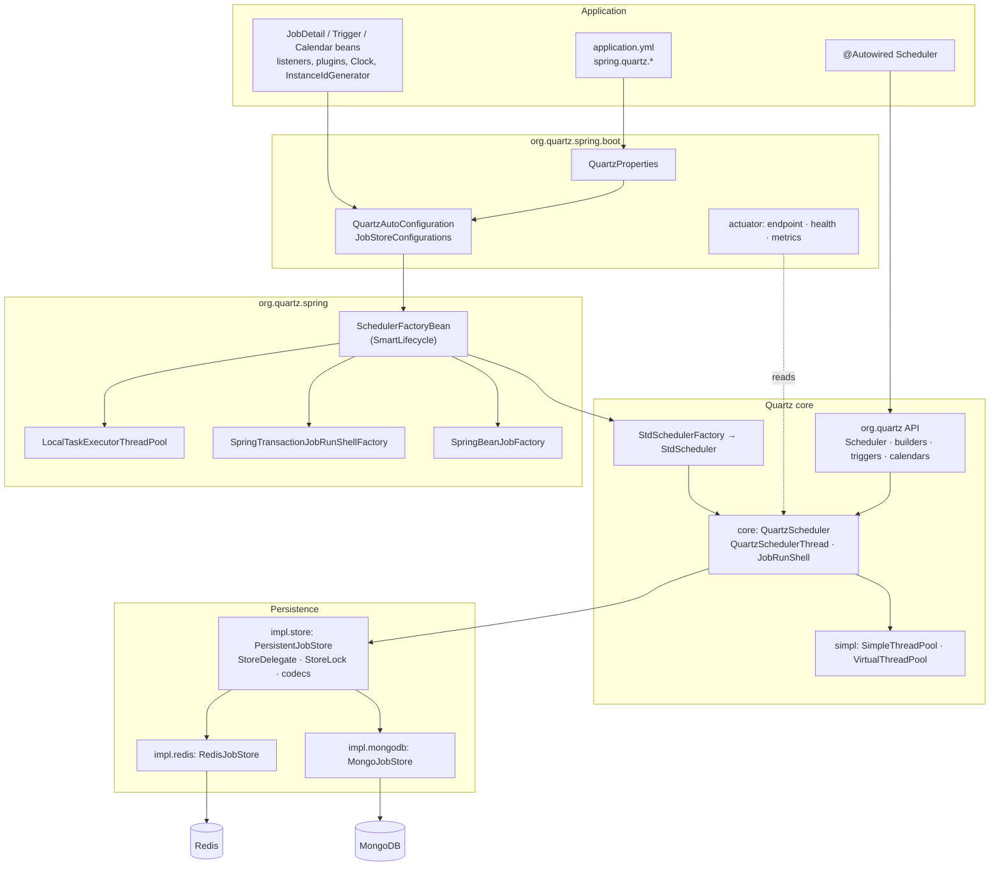
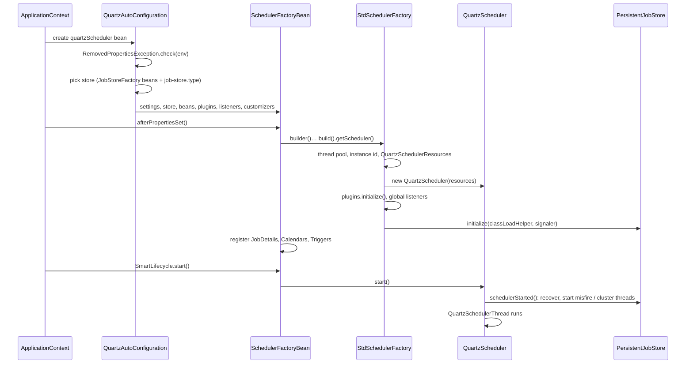
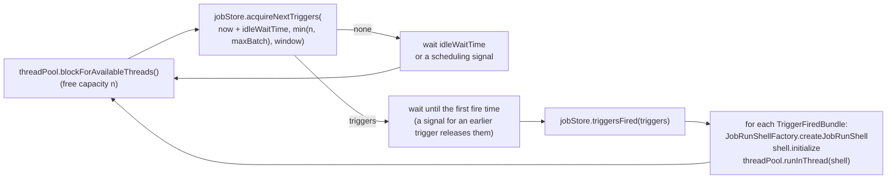
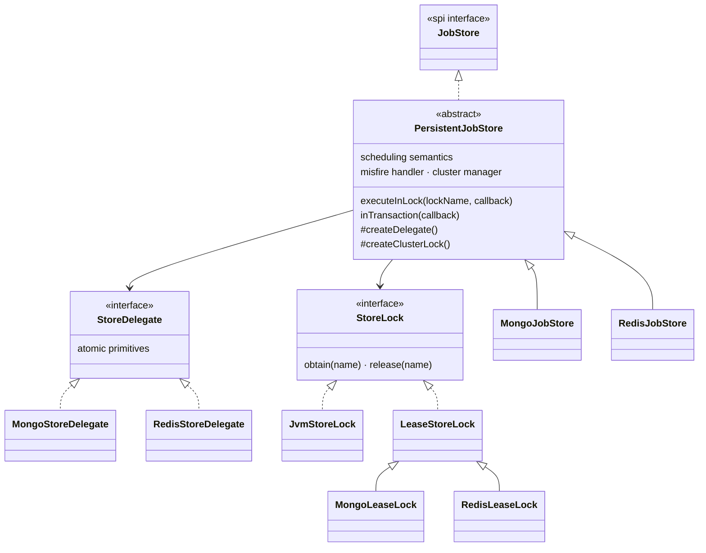
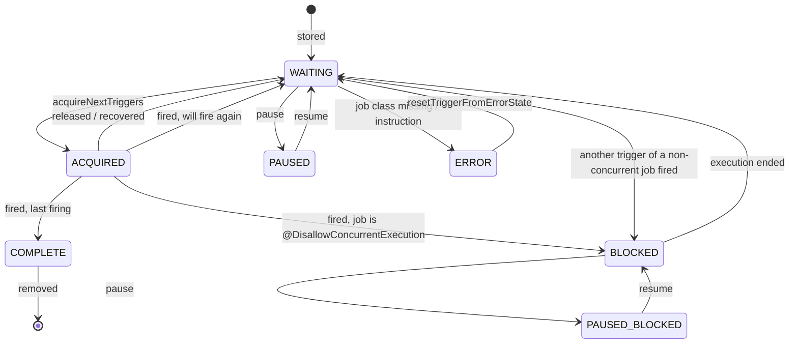

# Developer guide

This guide is for people working **on** `spring-boot-quartz-scheduler`: how it is built, how its parts fit
together, and where to make a change. For **using** the library (dependency, `application.yml`, beans,
actuator), read the [README](README.md). Every design decision has an entry in [DECISIONS.md](DECISIONS.md)
(`D-001` … `D-034`); this guide cites them where the reason matters.

- [1. What the library is](#1-what-the-library-is)
- [2. Architecture](#2-architecture)
- [3. Package map](#3-package-map)
- [4. Runtime: from startup to a job execution](#4-runtime-from-startup-to-a-job-execution)
- [5. Job stores](#5-job-stores)
- [6. Thread pools](#6-thread-pools)
- [7. Spring and Spring Boot integration](#7-spring-and-spring-boot-integration)
- [8. Configuration model](#8-configuration-model)
- [9. Cross-cutting conventions](#9-cross-cutting-conventions)
- [10. Build and tooling](#10-build-and-tooling)
- [11. Testing](#11-testing)
- [12. How to …](#12-how-to-)
- [13. Invariants and pitfalls](#13-invariants-and-pitfalls)

---

## 1. What the library is

A self-contained fork of the **Quartz Scheduler core** (2.5.x), reshaped into a **Spring Boot 4 library for
Java 25**:

| Kept from Quartz | Changed | Removed |
|---|---|---|
| Package `org.quartz` and the usage model: `JobBuilder`, `TriggerBuilder`, schedule builders, `Scheduler`, `Job`, `JobDetail`, `Trigger`, listeners, calendars, keys, matchers | Types: `Date` → `Instant`, millisecond intervals → `Duration`, `TimeZone` → `ZoneId`, `java.util.Calendar` → `ZonedDateTime` (D-010) | `quartz.properties` and reflective `Properties` wiring (D-012) |
| Scheduler engine (`QuartzScheduler`, scheduler thread, job run shells) | Configuration: typed records bound from `application.yml` (D-012, D-030) | JDBC stores, `RAMJobStore`, JTA, JNDI, RMI, JMX, servlet/EE integration, XML job loading (D-002, D-009, D-016, D-019) |
| The scheduling semantics of Quartz's JDBC store (`JobStoreSupport`) | Persistence: **MongoDB** and **Redis** stores only (D-014, D-016) | |
| Spring's `SchedulerFactoryBean` and friends (ported under `org.quartz.spring`) | Spring Boot auto-configuration, actuator, metrics under `org.quartz.spring.boot` (never `org.springframework.*`, to avoid split packages) | |

The history of the refactor is in [REFACTOR_PLAN.md](REFACTOR_PLAN.md) (phases 0–12) and [INVENTORY.md](INVENTORY.md).

---

## 2. Architecture



Four layers, each usable without the ones above it:

1. **Quartz core** (`org.quartz`, `core`, `impl`, `simpl`, `spi`, triggers, calendars, matchers, listeners,
   plugins, `utils`): the scheduling engine and its public API. `StdSchedulerFactory.builder()` creates a
   scheduler without Spring.
2. **Persistence** (`impl.store`, `impl.store.codec`, `impl.mongodb`, `impl.redis`): `JobStore`
   implementations. `PersistentJobStore` holds every scheduling rule; the two stores only implement storage
   primitives (`StoreDelegate`) and a cluster lock (`StoreLock`).
3. **Spring integration** (`org.quartz.spring`): `SchedulerFactoryBean` (lifecycle, beans → scheduler),
   Spring-aware job factory, transactions around jobs, executor-backed thread pool.
4. **Spring Boot** (`org.quartz.spring.boot`): auto-configuration from `application.yml` and beans, failure
   analysis, actuator endpoint, health indicator, Micrometer metrics.

---

## 3. Package map

| Package | Contents | Notes |
|---|---|---|
| `org.quartz` | Public API: `Scheduler`, `Job`, `JobDetail`, `Trigger` and its four sub-interfaces, the builders (`JobBuilder`, `TriggerBuilder`, `SimpleScheduleBuilder`, `CronScheduleBuilder`, `CalendarIntervalScheduleBuilder`, `DailyTimeIntervalScheduleBuilder`, `DateBuilder`), `CronExpression`, `TimeOfDay`, `JobDataMap`, listeners, `Calendar`, annotations (`@DisallowConcurrentExecution`, `@PersistJobDataAfterExecution`, `@ExecuteInTransaction`), exceptions | Keep signatures stable: this is the compatibility surface (CLAUDE.md) |
| `org.quartz.core` | `QuartzScheduler` (the engine), `QuartzSchedulerThread` (the scheduling loop), `JobRunShell` (one execution), `ListenerManagerImpl`, `QuartzSchedulerResources`, `SchedulerSignalerImpl` | Internal; applications get `StdScheduler`, which delegates here |
| `org.quartz.impl` | `StdSchedulerFactory` (+ `Builder`), `StdScheduler`, `JobDetailImpl`, `JobExecutionContextImpl`, `SchedulerRepository` (JVM-wide scheduler registry) | |
| `org.quartz.impl.config` | Records `SchedulerSettings`, `ThreadPoolSettings`, `JobStoreSettings`, `QuartzSettings` | Validated, immutable, with builders and `defaults()`; every duration is a `Duration` |
| `org.quartz.impl.triggers` | `AbstractTrigger`, `SimpleTriggerImpl`, `CronTriggerImpl`, `CalendarIntervalTriggerImpl`, `DailyTimeIntervalTriggerImpl` | Fire-time algorithms; guarded by the golden tests (§11) |
| `org.quartz.impl.calendar` | `BaseCalendar`, annual, cron, daily, holiday, monthly, weekly calendars | |
| `org.quartz.impl.matchers` | Key / name / group matchers and `and`/`or`/`not` | Listener selection |
| `org.quartz.impl.store` | `PersistentJobStore`, `StoreDelegate`, `StoreLock` (`JvmStoreLock`, `LeaseStoreLock`), `FiredTriggerRecord`, `SchedulerStateRecord` | The store semantics (§5) |
| `org.quartz.impl.store.codec` | `JobDetailCodec`, `TriggerCodec`, `JobDataCodec`, `SerializationCodec`, `Fields` | Store-neutral field maps; field names are the stored format |
| `org.quartz.impl.mongodb` | `MongoJobStore`, `MongoStoreDelegate`, `MongoJobStoreSettings` | |
| `org.quartz.impl.redis` | `RedisJobStore`, `RedisStoreDelegate`, `RedisKeys`, `RedisScripts` (Lua), `RedisJobStoreSettings` | |
| `org.quartz.simpl` | `SimpleThreadPool`, `VirtualThreadPool`, job factories, class-load helpers, instance-id generators | |
| `org.quartz.spi` | Extension interfaces: `JobStore`, `ThreadPool`, `JobFactory`, `SchedulerPlugin`, `InstanceIdGenerator`, `ClassLoadHelper`, `OperableTrigger`, `TriggerFiredBundle` | |
| `org.quartz.listeners`, `org.quartz.plugins.*` | Listener base classes and broadcasters; job/trigger history logging, job interrupt monitor | Plugins are beans (D-030) |
| `org.quartz.utils` | `Key`, `DirtyFlagMap`/`StringKeyDirtyFlagMap`, `LenientDateTime`, `Instants`, `InstantMessageFormat`, `ClassUtils` | |
| `org.quartz.spring` | `SchedulerFactoryBean`, `SchedulerAccessor`, `SpringBeanJobFactory`, `QuartzJobBean`, factory beans, `LocalTaskExecutorThreadPool`, `SpringTransactionJobRunShell(Factory)`, `MongoJobDataTransactions` | Ported from Spring Framework 7 (D-013) |
| `org.quartz.spring.boot.autoconfigure` | `QuartzAutoConfiguration`, `JobStoreConfigurations`, `QuartzProperties`, failure analyzers, endpoint/health/metrics auto-configurations, `RemovedPropertiesException` | Ported from Spring Boot 4 (D-013, D-017) |
| `org.quartz.spring.boot.actuate.*` | `QuartzEndpoint` (+ web extension), `QuartzHealthIndicator`, `QuartzMetrics` (a plugin) | |

Every package is `@NullMarked` (D-020, D-026): see §9.

---

## 4. Runtime: from startup to a job execution

### 4.1 Startup



`StdSchedulerFactory.instantiate()` is the place to read for the exact order. A non-Spring application does the
same through `StdSchedulerFactory.builder().jobStore(...).build().getScheduler()`.

### 4.2 The scheduling loop (`QuartzSchedulerThread.run`)



Points that matter when changing it:

- The **capacity** the pool reports bounds how many triggers are acquired (`min(free capacity,
  batch-trigger-acquisition-max-count)`). Pools must report real capacity (D-023, D-027, D-031); an "unknown"
  answer serializes acquisition and a wrong one queues fired jobs where no other node can run them.
- `runInThread` returning `false` puts the fired triggers into `ERROR`: pools wait or refuse only in exceptional
  cases.
- The thread is a **platform thread** even with virtual worker threads; it is interrupted when the scheduler
  halts.
- Scheduling time comes from `SchedulerSignaler#getCurrentTime()`, i.e. the configured `java.time.Clock`
  (`Clock` bean or `StdSchedulerFactory.Builder.clock`), so tests can move time (`MutableClock`).

### 4.3 One job execution (`JobRunShell.run`)

1. MDC `quartz.jobKey`, `quartz.triggerKey`, `quartz.fireInstanceId` are set (D-028).
2. `begin()` — the transactional shell opens nothing here; it wraps `executeJob` instead.
3. Trigger and job listeners `triggerFired` / `vetoJobExecution` / `jobToBeExecuted`; a veto skips the job.
4. `executeJob(job, context)` — `SpringTransactionJobRunShell` runs it in a Spring transaction when the job class
   has `@ExecuteInTransaction` or `spring.quartz.transaction.enabled` is set.
5. Listeners `jobWasExecuted`, `trigger.executionComplete(...)` → a `CompletedExecutionInstruction`,
   `triggerComplete` listeners.
6. `RE_EXECUTE_JOB` loops; otherwise `jobStore.triggeredJobComplete(...)` stores the outcome.
7. MDC keys are removed (pool threads are reused).

The job instance comes from the `JobFactory`: in Spring, `SpringBeanJobFactory` autowires the job and applies
`JobDataMap` values to its setters.

### 4.4 Shutdown

`SchedulerFactoryBean` listens for its context's `ContextClosedEvent` and shuts the scheduler down **before** the
context stops its lifecycle beans, so the store's connection (`LettuceConnectionFactory`, the `MongoClient`) is
still open while running jobs report completion (D-018). With
`spring.quartz.wait-for-jobs-to-complete-on-shutdown` the thread pool waits for running jobs; the scheduler
thread is interrupted, which is why every store call is written to survive an interrupt (§13).

---

## 5. Job stores

### 5.1 Structure



`PersistentJobStore` is a port of `JobStoreSupport`: it knows trigger states, paused groups, blocking of
non-concurrent jobs, misfires, recovery and clustering. A `StoreDelegate` only reads and writes, and each of its
methods must be **atomic on its own** (one conditional update, one Lua script). Compound operations run in
`executeInLock(lockName, callback)`:

- the lock is `JvmStoreLock` (in-process) for a non-clustered store, a `LeaseStoreLock` (in the database) for a
  clustered one;
- `inTransaction` wraps the callback in a MongoDB transaction when the deployment supports them; Redis has none;
- the per-operation state (held locks, the pending scheduling signal, the MongoDB session) is a `ScopedValue`
  bound for the operation (D-022).

### 5.2 Trigger states



Next to the trigger, a **fired-trigger record** (`FiredTriggerRecord`) exists for every trigger an instance has
acquired (`ACQUIRED`) or is executing (`EXECUTING`), naming the instance. Records are what recovery works from:

- **Acquisition order (D-034):** the record is written **before** the `WAITING → ACQUIRED` change. On a store
  without transactions the two are separate writes; an instance that stops between them must leave a record, or
  recovery cannot free the trigger. A record for a trigger that is still `WAITING` is harmless.
- **Recovery** of a failed instance frees its `ACQUIRED` triggers (unless another instance holds a record for
  them), re-schedules `requestsRecovery` jobs that were executing, unblocks non-concurrent jobs and deletes its
  records.

### 5.3 Background threads

| Thread | When | What |
|---|---|---|
| `…_MisfireHandler` | always | Applies misfire instructions to triggers whose next fire time is older than `now − misfire-threshold` (`recoverMisfiredJobs`), at most `max-misfires-to-handle-at-a-time` per pass; a pass runs every `misfire-threshold`, sooner when the last one left triggers over |
| `…_ClusterManager` | clustered | Checks in every `cluster-checkin-interval` (`SchedulerStateRecord`), detects instances whose check-in is older than interval + `cluster-checkin-misfire-threshold`, recovers them under the `STATE_ACCESS` and `TRIGGER_ACCESS` locks |

On startup (`schedulerStarted`) a store frees its own `ACQUIRED`/`BLOCKED` triggers, removes stale fired records
and recovers in-progress jobs from its previous run (non-clustered), or does so through the first cluster check-in.

### 5.4 Locks

`LeaseStoreLock` (both stores): a lease is "owner id + expiry" written atomically; others poll every 50 ms
(`JobStoreSettings.acquireTriggersWithinLockRetry`) until it is released or has expired. A dead instance blocks the others for at
most the lease time (`mongodb.lock-timeout` 10 min, `redis.lock-timeout` 30 s). Releasing clears the thread's
interrupt flag first, because the interrupted scheduler thread at shutdown must still give its lease back.

### 5.5 MongoDB store

- **Collections** (prefix `qrtz_`): `jobs`, `triggers`, `calendars`, `paused_groups`, `fired_triggers`,
  `schedulers`, `locks`. Every document carries the scheduler name, so schedulers can share them; indexes are
  created at startup (`MongoIndexesIT`).
- **Database:** the application's (`MongoDatabaseFactory`, else `spring.mongodb.database`, else the connection
  string's), see `JobStoreConfigurations` (D-030, D-032).
- **Transactions:** on a replica set or sharded cluster every store operation is a transaction and trigger
  acquisition always takes the trigger lock (avoids write conflicts). On a standalone server the store still works:
  each primitive is a single atomic operation.
- **Failure safety:** a failed transaction is aborted with the interrupt flag cleared, and its server session is
  killed and marked dirty, because the driver ignores abort errors and an open transaction would hold its locks for
  60 s (`MongoJobStore.abort`, D-032).
- **Job transactions:** with a `MongoTransactionManager` on the same `MongoClient`, the job data of a
  `@PersistJobDataAfterExecution` job is written in the job's own transaction (`MongoJobDataTransactions`).
- **Lease locks** are documents in `locks` with `expiresAt` (also a TTL index as a safety net).

### 5.6 Redis store

- **Keys** are `{keyPrefix}{schedName}:…` (prefix `quartz:`); the `{schedName}` hash tag keeps a scheduler in one
  slot, so Redis Cluster works. Layout (`RedisKeys`): `job:<k>`, `jobs:<group>`, `job_groups`, `trigger:<k>`,
  `triggers:<group>`, `trigger_groups`, `job_triggers:<k>`, `calendar_triggers:<name>`, `state:<STATE>`, `waiting`
  and `waiting_ignore_misfire` (sorted by next fire time), `calendars`, `paused_trigger_groups`,
  `paused_job_groups`, `fired:<id>`, `fired_ids`, `fired_by_instance:<id>`, `fired_by_job:<k>`,
  `fired_by_trigger:<k>`, `fired_instances`, `schedulers`, `lock:<name>`. Names are escaped (`%`, `:`).
- **Atomicity:** every multi-key change is one Lua script (`RedisScripts`: `STORE_JOB`, `STORE_TRIGGER`,
  `SET_STATE` (conditional), `INSERT_FIRED`, `DELETE_FIRED`, `ACQUIRE_LOCK`, `RELEASE_LOCK`, …), tested by
  `RedisLuaScriptsIT`. There are no transactions across scripts — hence the write order rules of §5.2.
- **Leases:** `SET NX PX`, released by compare-and-delete.
- **Durability** is Redis's: use AOF (`appendonly yes`).

### 5.7 Codecs

`JobDetailCodec` / `TriggerCodec` turn jobs and triggers into store-neutral `Map<String, Object>` (MongoDB stores
them as documents, Redis as hashes of strings). Instants are epoch milliseconds; the four built-in trigger types
have their own fields, others are Java-serialized (`TYPE_BLOB`). `JobDataCodec` keeps simple job data values
typed (type-tagged strings in Redis) and Java-serializes the map when a value is not simple. The constants are
the stored field names: **renaming one is a data migration**.

---

## 6. Thread pools

| Pool | Selected by | Capacity reported | Notes |
|---|---|---|---|
| `SimpleThreadPool` | default | free worker threads | `thread-count` platform threads |
| `VirtualThreadPool` | `spring.quartz.thread-pool.virtual-threads: true` (or `ThreadPoolSettings.virtualThreads`) | `thread-count − running` | New virtual thread per job; independent of `spring.threads.virtual.enabled` (D-027) |
| `LocalTaskExecutorThreadPool` | `SchedulerFactoryBean#setTaskExecutor` (e.g. through a `SchedulerFactoryBeanCustomizer`) or `setThreadPool(new LocalTaskExecutorThreadPool(executor, n))` | the executor's real limit; an executor without one is capped at `thread-count` (D-023, D-031) | Reads `ThreadPoolTaskExecutor`, `ThreadPoolExecutor`, `ThreadPoolTaskScheduler`, `ConcurrentTaskExecutor`, limited `SimpleAsyncTaskExecutor`; warns when it cannot |

Each pool's `describe()` is printed in the startup summary. A new pool must implement `blockForAvailableThreads`
truthfully, free its slot on every failure path, and wait on `shutdown(true)`.

---

## 7. Spring and Spring Boot integration

### 7.1 `SchedulerFactoryBean`

A port of Spring's class, rebuilt on `StdSchedulerFactory.Builder` instead of `Properties`. It is a
`FactoryBean<Scheduler>`, `SmartLifecycle` (starts after the context is refreshed, optional `startupDelay`) and
`ApplicationListener<ContextClosedEvent>` (§4.4). It registers jobs, triggers and calendars after the scheduler is
created (`overwrite-existing-jobs`), installs `SpringBeanJobFactory`, and — inside an application context —
`SpringTransactionJobRunShellFactory`, which runs `@ExecuteInTransaction` jobs (or every job, with
`transactionalJobs`) in a Spring transaction.

### 7.2 Auto-configuration

`QuartzAutoConfiguration` (after Spring Boot's MongoDB, Spring Data MongoDB and Redis auto-configurations):

- creates the `SchedulerFactoryBean` unless the application defines a `Scheduler` or `SchedulerFactoryBean`;
- collects `JobDetail`, `Trigger`, `Calendar` (by bean name), `JobListener`, `TriggerListener`,
  `SchedulerListener`, `SchedulerPlugin` (by bean name) beans, a unique `Clock` / `InstanceIdGenerator`, and
  applies `SchedulerFactoryBeanCustomizer` beans last; plugin beans that are also listeners are not registered a
  second time as global listeners (D-032);
- chooses the store from `JobStoreFactory` beans (`JobStoreConfigurations`: one per store whose client and
  connection bean are present) and `spring.quartz.job-store.type`, failing with `JobStoreUnavailableException`;
- fails with `RemovedPropertiesException` when the environment sets a removed `spring.quartz.*` key (D-032).

Both exceptions have a `FailureAnalyzer`, registered in `META-INF/spring.factories` (Spring Boot still loads
failure analyzers from there). The auto-configuration classes are listed in
`META-INF/spring/org.springframework.boot.autoconfigure.AutoConfiguration.imports`.

### 7.3 Actuator

`QuartzEndpointAutoConfiguration`, `QuartzHealthContributorAutoConfiguration`, `QuartzMetricsAutoConfiguration`
add the `quartz` endpoint (same JSON as Spring Boot's), the `quartz` health indicator (DOWN when shut down, the
store is unreadable, or the clustered check-in is overdue) and Micrometer meters (`QuartzMetrics` is a scheduler
plugin listening to jobs and triggers). See the README's Actuator section for the user view.

---

## 8. Configuration model

```mermaid
flowchart LR
  yml["application.yml<br/>spring.quartz.*"] --> qp["QuartzProperties<br/>(records, @DefaultValue)"]
  qp -->|toSettings()| s["SchedulerSettings<br/>ThreadPoolSettings<br/>JobStoreSettings"]
  qp --> m["MongoJobStoreSettings<br/>RedisJobStoreSettings"]
  s --> sfb["SchedulerFactoryBean.setSettings"] --> f["StdSchedulerFactory.Builder"]
  m --> st["MongoJobStore / RedisJobStore constructors"]
```

- `QuartzProperties` is the **only** binding target; every duration is a `Duration`. It exposes a deliberate
  subset (29 keys): options with one sensible value in a Spring Boot application are not properties and keep the
  defaults of the settings records (D-030). Plain Java users still set them on the builders.
- Settings records validate in their compact constructors and have builders; their `defaults()` equal the
  property defaults, apart from the scheduler name (`QuartzPropertiesTest#defaultsMatchTheTypedSettingsDefaults`).
- **Metadata:** `spring-boot-configuration-processor` generates `META-INF/spring-configuration-metadata.json` from
  the records' Javadoc `@param`s (written as sentences); hints and the removed keys (error-level deprecations)
  are in `src/main/resources/META-INF/additional-spring-configuration-metadata.json`. The README table is generated
  from the merged file (`ConfigurationMetadataTest` checks it).

---

## 9. Cross-cutting conventions

- **Time:** `java.time` everywhere in the API. Fire-time algorithms keep the original lenient `Calendar` semantics
  through `LenientDateTime` (field arithmetic, DST handling) so their results match Quartz 2.x exactly (D-010);
  instants are kept at millisecond precision (`Instants`). Message templates with `{n, date, …}` use
  `InstantMessageFormat`.
- **Nullness:** every package is `@NullMarked` (JSpecify), and **NullAway fails the build** (D-025, D-026). Mark
  with `@Nullable` wherever null is possible; fields set after construction take
  `@SuppressWarnings("NullAway.Init")`; any `@SuppressWarnings("NullAway")` carries a comment. Null-in/null-out
  helpers use Spring's `@Contract`.
- **Spring code location:** under `org.quartz.spring…`, never `org.springframework.…`.
- **Licence headers:** Apache 2.0 on every file; ported files keep their original copyright lines (`NOTICE`
  credits Quartz and Spring).
- **Logging:** SLF4J only.
- **Decisions:** anything ambiguous gets a `DECISIONS.md` entry, with the conservative choice taken.

---

## 10. Build and tooling

| Item | Detail |
|---|---|
| JDK | 25 (`.sdkmanrc`: Temurin 25.0.4); the enforcer requires ≥ 25 |
| Build | Maven wrapper: `./mvnw verify` (unit + container tests, NullAway, dependency analysis) |
| Formatting | `fmt-maven-plugin` (google-java-format) **rewrites sources on every build**: commit what it produces; `-Dfmt.skip` to skip locally |
| Static checks | Error Prone with only NullAway enabled, on main code (D-025); `.mvn/jvm.config` opens the `jdk.compiler` internals it needs |
| Dependencies | `dependency:analyze-only` with `failOnWarning`: declare what you use, nothing more. Store/actuator dependencies are `optional` |
| Javadoc | `./mvnw javadoc:javadoc`; the sources/javadoc jars are built only by `-Ppublish-artefacts` (D-029). Check before a release: `./mvnw -Ppublish-artefacts -Dgpg.skip -DskipTests package` |
| Release | `publish-artefacts` profile: sources, javadoc, GPG signing, `central-publishing-maven-plugin` |
| Version | Set in `pom.xml`; `quartz-build.properties` (filtered) carries it to `QuartzScheduler.getVersion()` |

After changing the Java release or the plugin set, run `clean verify`: incremental builds have kept stale classes.

---

## 11. Testing

| Kind | Naming / runner | What |
|---|---|---|
| Unit | `*Test`, Surefire, one JVM per class | API, triggers, calendars, codecs, settings, thread pools, Spring pieces without a store |
| Container | `*IT`, Failsafe | Anything touching MongoDB or Redis, with real containers |
| Store contract | `org.quartz.store.AbstractJobStoreContractTest`, `AbstractClusteredJobStoreContractTest` | One suite run against both stores (`MongoJobStoreIT`, `RedisJobStoreIT`, `…ClusteredJobStoreIT`): add store behaviour tests **here** |
| Golden | `GoldenBehaviourTest` + `src/test/resources/org/quartz/golden/*.tsv.gz` | Fire times recorded from the original Quartz 2.x for simple, cron, calendar-interval, daily-time-interval triggers and calendars, across time zones and DST; the refactored algorithms must reproduce them |
| Spring / Boot | `SchedulerFactoryBeanIT`, `QuartzAutoConfigurationIT` (`ApplicationContextRunner`), actuator ITs, `SampleApplicationIT` | `SampleApplicationIT` runs a real application on {MongoDB, Redis} × {single, 2-node cluster} × {transactions on, off}, including fail-over |

Container rules (CLAUDE.md):

- Docker must be running — check `docker info` first; never disable or mock container tests.
- Containers are shared per JVM (`SharedContainers`, `AbstractMongoIT`, `AbstractRedisIT`): `mongo:8.0` as a
  single-node replica set (transactions work), `redis:7.4`. Pin image tags.
- Clean state by dropping collections / `FLUSHDB` after each test (the base classes do), never by restarting
  containers.
- Clustered tests start ≥ 2 schedulers against the same container.
- Awaitility for anything asynchronous; no `Thread.sleep`.
- A test that gives a context its **own** `MongoClient` must keep it open (`setDestroyMethodName("")` on the shared
  client), or a closing scheduler can leave a server-side transaction that blocks the next drop (D-032).

Run a single test class:

```bash
./mvnw verify -Dtest=NoSuchTest -Dsurefire.failIfNoSpecifiedTests=false -Dit.test=RedisClusteredJobStoreIT -Dfailsafe.failIfNoSpecifiedTests=false
```

---

## 12. How to …

**Add a configuration property.** Add a component to the right record in `QuartzProperties` with a `@param`
sentence and `@DefaultValue`; map it in `toSettings()` (or the store settings); add the setting to the core record
and builder if it does not exist; extend `QuartzPropertiesTest`; regenerate the README table from the metadata. If
it replaces an old key, add the old key to `RemovedPropertiesException.REMOVED` and to the additional metadata.

**Change store behaviour.** Put the rule in `PersistentJobStore` (both stores get it) and keep `StoreDelegate`
methods atomic. If you need a new primitive, add it to `StoreDelegate` and implement it in both delegates — for
Redis as a Lua script when it touches several keys. On stores without transactions, order writes so that stopping
between them is recoverable (§5.2). Add a contract test.

**Add a job store.** Extend `PersistentJobStore`; implement `createDelegate` (a `StoreDelegate`), `createClusterLock`
(usually a `LeaseStoreLock` subclass with `tryAcquire`/`releaseLease`), and `inTransaction` if the store has
transactions; extend the two contract test bases; add a `JobStoreFactory` registration in `JobStoreConfigurations`
and a `JobStoreType`.

**Add a thread pool.** Implement `ThreadPool` (see §6 for the obligations), override `describe()`, and select it
in `StdSchedulerFactory.createThreadPool` from a `ThreadPoolSettings` value.

**Write a plugin.** Implement `SchedulerPlugin` (and `JobListener`/`TriggerListener` if it listens; register
yourself in `initialize` with your matchers). Applications define it as a bean.

**Change a fire-time algorithm.** Expect `GoldenBehaviourTest` to fail; a deliberate change needs a
`DECISIONS.md` entry and regenerated fixtures (D-011 is an example).

---

## 13. Invariants and pitfalls

- **Interrupts at shutdown.** The scheduler, misfire and cluster threads are interrupted when the scheduler halts,
  often in the middle of a store call. Lettuce and the MongoDB driver throw on interrupted threads, and a command
  may have reached the server even though the client gave up. Hence: release locks and abort transactions with the
  interrupt flag cleared, kill MongoDB sessions after a failed transaction, and write fired-trigger records before
  state changes (D-032, D-034).
- **No unbounded concurrency.** A pool that reports more capacity than it can run makes the scheduler acquire
  triggers that then wait in a queue, invisible to other cluster nodes (D-023, D-031).
- **Acquired triggers need records.** Never mark a trigger `ACQUIRED` without its fired-trigger record existing
  first, and never free an `ACQUIRED` trigger another instance holds a record for.
- **Stored field names are a format.** Codec constants, Redis key shapes and MongoDB collection names are read by
  running clusters; changing them needs a migration.
- **`SchedulerFactoryBean` shuts down on `ContextClosedEvent`,** not in `destroy()`: lifecycle beans the store
  depends on are stopped right after.
- **The formatter rewrites code.** Never hand-format; long Javadoc lines are re-wrapped, which can move `@` to the
  start of a line (write `{@code @Annotation}` in prose).
- **Removed properties fail startup** by design: do not silently re-add or ignore old keys.
